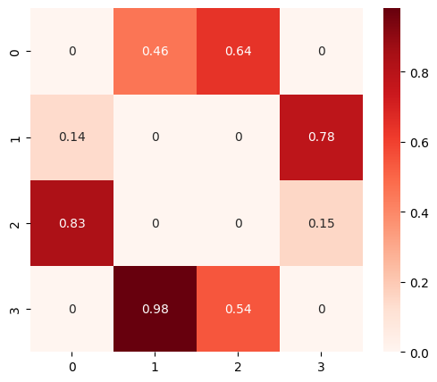
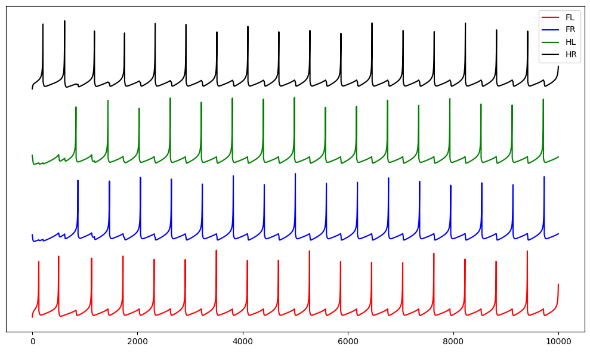

# Spiking Neural Network CPG with Trot-Gait Plasticity

### Project Description
A simulation of a quadruped Central Pattern Generator (CPG) built from **Izhikevich neurons (2003)**. A teacher signal trains the network, using a **simplified trace-based, anti-Hebbian plasticity rule**, to settle into a **trot** gait (diagonal limb pairs FL/HR and FR/HL fire together).

This is a learning exercise, not a full STDP model. The rule only potentiates, with no depression term and no timing window. Equations are integrated with Euler's method at **dt = 0.1 ms**.

### What is learned and what is built in
- **Learned:** the strengths of the inhibitory connections between competing limbs, starting from random weights.
- **Built in:** the teacher signal drives the diagonal pairs in alternation, and the weights between diagonal partners are fixed at zero by design (`partner = 3 - i`).
- So the network does not discover the trot from scratch. It learns to sustain a rhythm whose structure is largely imposed.

### Numerical stability note
With dt = 0.5 ms the voltage diverged (values reached ~1e159); dt = 0.1 ms fixed it. My hypothesis is that the synaptic term `-g(v - E)` makes the Euler update unstable for large `g·dt`, and that the `v²` term is largely caught by the spike reset. **I have not yet tested this.**

### Visuals
**1. Learned synaptic weights**



*Strong inhibition forms between competing limbs (e.g. FL vs FR); diagonal partners stay uncoupled by construction.*

**2. Test run (no teacher signal)**

*The network generates an alternating rhythm with diagonal pairs firing together.*

### Limitations / next steps
- Add a depression term and a proper STDP timing window.
- Remove the hard-coded partner constraint and see if the trot still emerges.
- Test robustness across random seeds.
- Test the Euler instability hypothesis directly (vary `g` and `dt`).

### How to Run
```bash
pip install numpy matplotlib seaborn
python main_learning.py     # random init -> teacher training -> test
python baseline_static.py   # hard-coded CPG (control)
```
